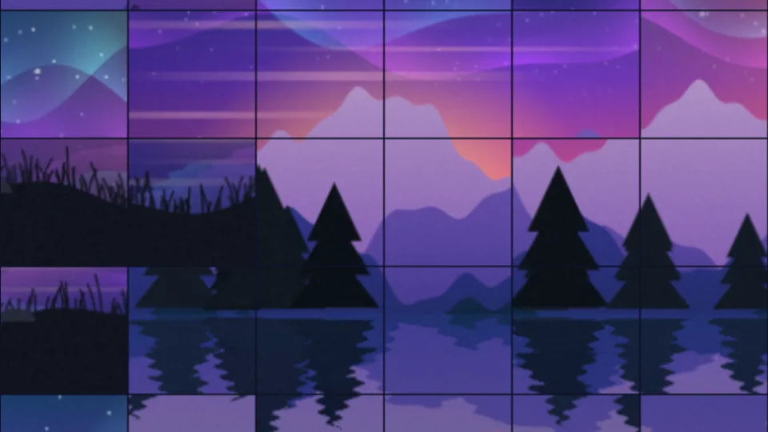
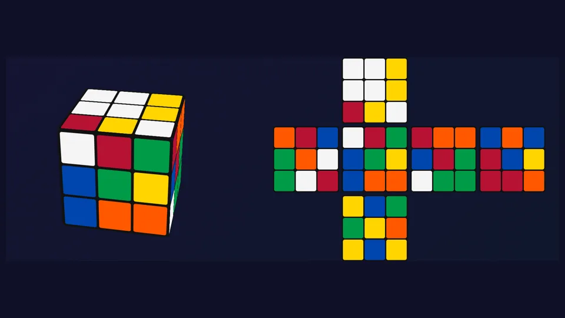
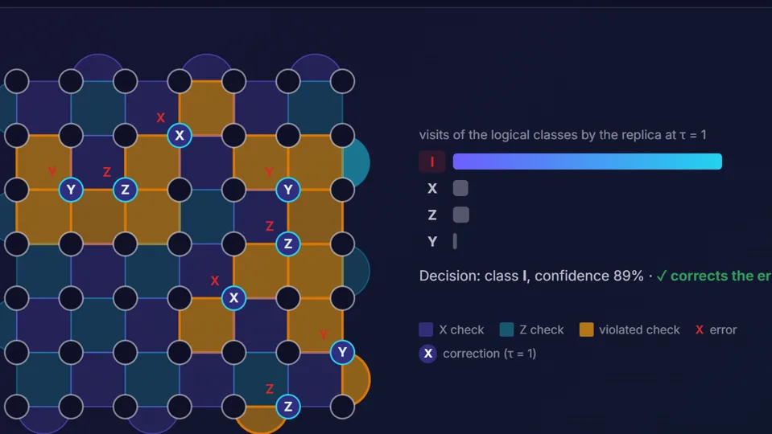
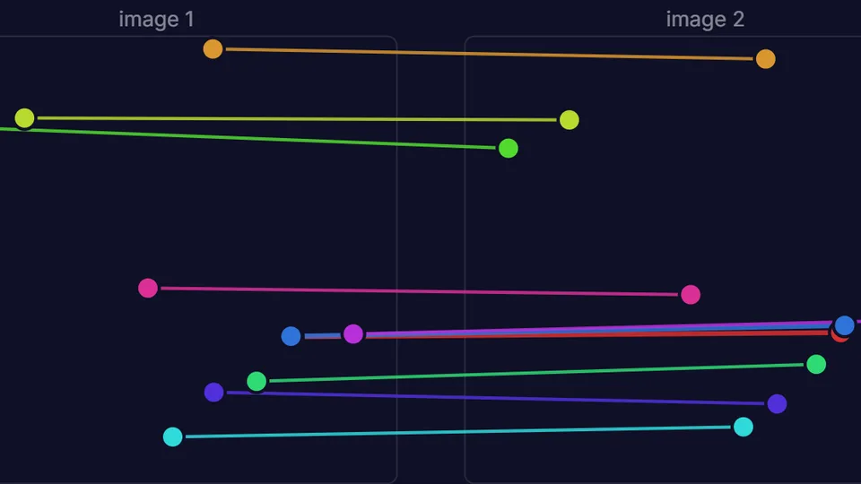
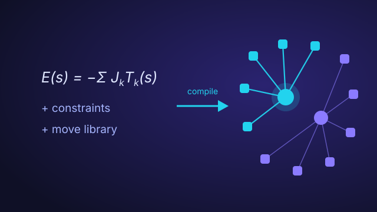

# Demos

Each demo runs NIMBUS in your browser: moves that keep every state valid, the Metropolis acceptance rule and an
annealing schedule or temperature ladder. Nothing is sent to a server.

-   [{ .nb-thumb loading=lazy }](jigsaw.md)

    __Jigsaw puzzle__

    A generated picture is cut into tiles and shuffled; the machine reassembles it with tile and block exchanges that
    keep every tile in exactly one slot.

    [:octicons-arrow-right-24: Open the demo](jigsaw.md)

-   [{ .nb-thumb loading=lazy }](rubik.md)

    __Rubik's cube__

    A scrambled cube solved by annealing. Face turns form the backbone; short commutators that move only a few pieces
    are the shortcuts that make it solvable.

    [:octicons-arrow-right-24: Open the demo](rubik.md)

-   [{ .nb-thumb loading=lazy }](surface_code.md)

    __Surface-code decoding__

    Place errors on a surface code and watch the machine sample corrections with stabilizer moves and decide the most
    likely logical class.

    [:octicons-arrow-right-24: Open the demo](surface_code.md)

-   [{ .nb-thumb loading=lazy }](graph_matching.md)

    __Graph matching__

    Two point sets; the machine matches every point of the first set to one point of the second. Drag any point to
    change the problem while it runs.

    [:octicons-arrow-right-24: Open the demo](graph_matching.md)

-   [{ .nb-thumb loading=lazy }](../concepts/derivation.md#8-the-machine)

    __The machine, step by step__

    Three beads in a row: derive the architecture, then run its encoder and decoder, with or without a shortcut
    move.

    [:octicons-arrow-right-24: Open the derivation](../concepts/derivation.md)

