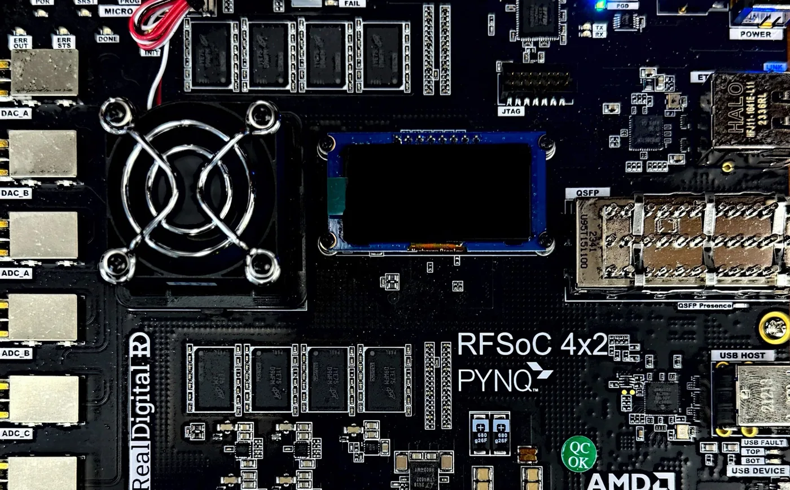
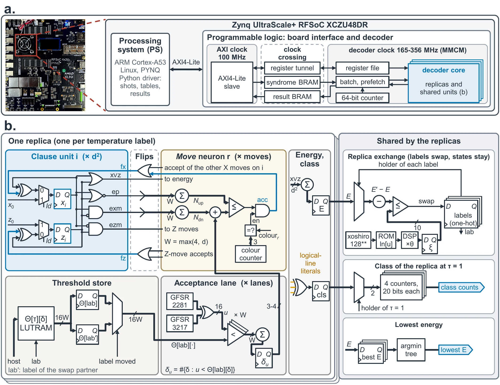
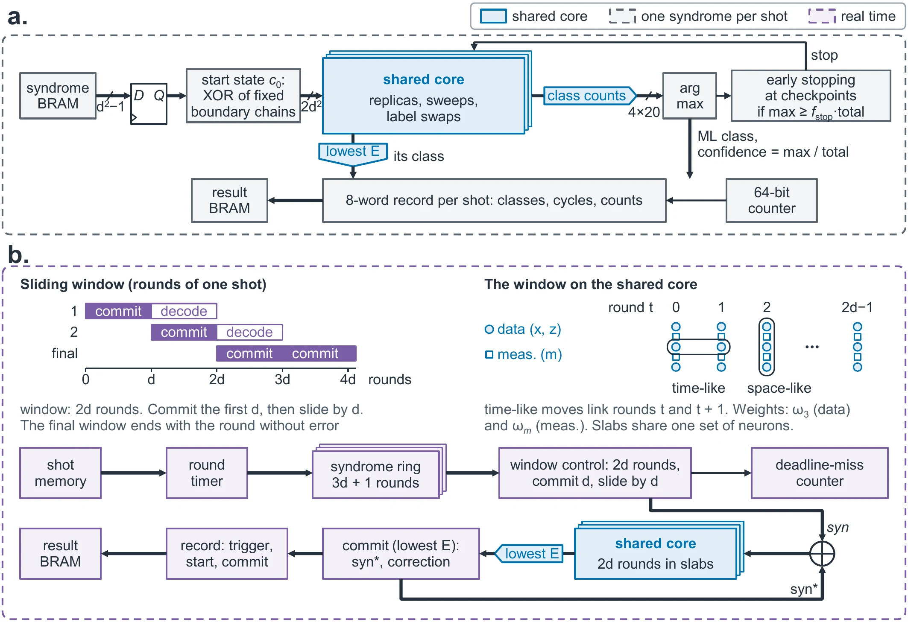

---
hide:
  - navigation
---

# FPGA decoders

<div class="nb-hw-hero" markdown>

<div markdown>
Two surface-code decoders built from the NIMBUS architecture run on a Real Digital **RFSoC 4x2** board (AMD Xilinx
Zynq UltraScale+ XCZU48DR-2). Both sample the logical classes of the rotated surface code with parallel tempering
(replica exchange) on the constrained Ising formulation of decoding.

- **One syndrome per shot**, code distances \(d = 3\) to \(15\)
- **Real time**, a syndrome stream with measurement errors, \(d = 3\) to \(11\)
- Bit-exact with the software models in `nimbus.decoding`
- Prebuilt bitstreams: no Vivado needed to run them

[:octicons-arrow-right-24: Run a decoder](#workflow){ .md-button .md-button--primary }
[:octicons-arrow-right-24: Surface-code decoding](../problems/surface_code.md){ .md-button }
</div>

{ .nb-hw-photo loading=lazy }

</div>

<div class="grid cards" markdown>

-   :material-sync:{ .lg .middle } __Two decoding modes__

    ---

    One syndrome per shot returns the most likely logical class and the lowest-energy class. Real time decodes a
    stream in sliding windows of \(2d\) rounds that commit \(d\) rounds each.

-   :material-check-decagram-outline:{ .lg .middle } __Bit-exact__

    ---

    For the same tables, seeds and syndromes, every replica's state, energy and class after every update, and every
    decision, equal those of the software model. The testbenches and the host tools check this.

-   :material-download-box-outline:{ .lg .middle } __12 prebuilt designs__

    ---

    Bitstreams for every code distance and mode, with their build parameters, clocks and utilization, in the release
    download and the Zenodo archive.

-   :material-laptop:{ .lg .middle } __Try it without a board__

    ---

    The board drivers run against register-level mocks in the test suite, and the xsim testbenches need no Vivado
    license.

</div>

## Architecture

The decoder core is the architecture of [How NIMBUS works](../concepts/index.md) in hardware: clause units hold the
clause bits of each replica, and every move neuron computes the energy change of its move from its clause units and,
when it accepts, flips them directly. Click a figure to open it at full resolution.

<figure class="nb-fig" markdown>
[{ loading=lazy }](../assets/img/hardware/fpga_decoder.webp){ target=_blank }
<figcaption markdown>
**The decoder on the RFSoC 4x2 board.** **a**, The system: the processing system runs the Python driver; the
programmable logic holds the board interface and the decoder core on its own clock. **b**, The core shared by both
decoding modes: per replica, the clause units, move neurons and acceptance lanes; shared by the replicas, replica
exchange, the class counters and the lowest-energy search. Supplementary Fig. S5 of the paper ([arXiv:2611.25352](https://arxiv.org/abs/2611.25352)).
</figcaption>
</figure>

??? info "Figure details"
    **a**, The Zynq UltraScale+ RFSoC XCZU48DR (under the heat sink) holds the processing system (PS), which runs the
    Python driver, and the programmable logic, which holds the board interface and the decoder core. The decoder core
    runs on its own clock (165–356 MHz). A register tunnel transfers settings between the two clock domains, and a
    64-bit counter time-stamps events on the decoder clock.

    **b**, Each replica holds its state in the clause units (blue): the clause unit of qubit \(i\) stores the bits
    \(x_i\) and \(z_i\), loaded with the start state. A move neuron counts its clause units,
    \(\Delta E/\omega_3 = N_\mathrm{up} - N_\mathrm{dn}\) over 4 or \(d\) units, and compares this count with the
    count \(\delta_u\) of its acceptance lane, which draws a 16-bit random number \(u\) and counts the entries above
    \(u\) in the threshold row of the replica's temperature label. When its colour class is active (moves of one
    colour share no clause unit and update in the same cycle), an accepting neuron flips the bits of its clause units
    directly, in a one-cycle loop. Shared by the replicas: replica exchange, which swaps the temperature labels and
    leaves the states in place; the energy and class registers; the class counters of the replica at \(\tau = 1\); and
    the lowest-energy search. Blue tags: the two outputs of the core, used by the decoding modes below.

<figure class="nb-fig" markdown>
[{ loading=lazy }](../assets/img/hardware/fpga_decoding_modes.webp){ target=_blank }
<figcaption markdown>
**What each decoding mode adds around the core.** **a**, One syndrome per shot: a start state from the syndrome, the
decision from the class counts, and early stopping. **b**, Real time: a round timer and a ring of syndromes feed
sliding windows of \(2d\) rounds on the same core; each window commits its first \(d\) rounds. Supplementary Fig. S6 of the paper ([arXiv:2611.25352](https://arxiv.org/abs/2611.25352)).
</figcaption>
</figure>

??? info "Figure details"
    Blue: the shared core, with its outputs (tags). Dashed frames: blocks used only in one mode (grey: one syndrome
    per shot, purple: real time).

    **a**, The start state \(c_0\) is the exclusive OR of fixed chains to the boundary for the violated checks. The
    decision is the most frequent logical class, from the four class counts, with its confidence. The run stops early
    at a checkpoint when the largest count reaches a set fraction of the counts since the previous checkpoint.

    **b**, A round timer releases the rounds of a stored shot into a ring memory of syndromes. Each window of \(2d\)
    rounds runs on the same core; time-like moves link the rounds, and stabilizer moves and logical operators act
    within one round. A non-final window commits the lowest-energy state and returns the correction of its first
    \(d\) rounds and the corrected syndrome that starts the next window. The final window commits the most frequent
    class. A counter records missed deadlines.

## Workflow

<div class="nb-flow">
<span><b>1</b>Get a bitstream</span><i></i><span class="nb-flow-opt"><b>2</b>Simulate <small>(optional)</small></span><i></i><span><b>3</b>Run on the board</span><i></i><span><b>4</b>Check bit for bit</span>
</div>

### 1. Get a bitstream

=== "Prebuilt (no Vivado)"

    Download `nimbus_bitstreams.zip` from the
    [v1.0 release](https://github.com/aimlab-wustl/Nimbus/releases/tag/v1.0) or the
    [Zenodo archive](https://doi.org/10.5281/zenodo.24182700). It holds the `.bit` and `.hwh` files of the 12 designs
    below, named `one_shot_d<d>` and `real_time_d<d>`, each with a `.json` of its build parameters, clocks, timing and
    utilization, and a `MANIFEST.txt` with the SHA-256 of every file.

=== "Build from source"

    Generate a core (or use one of the pre-generated cores in `hardware/cores/`), then build with Vivado in batch
    mode. A large design takes 1 to 4 hours.

    ```bash
    python hardware/gen/gen_pt.py --d 7 --NS 64 --K 2 --B 16 --p 0.12 --bmin 0.1 --out my_cores/pt_d7_ns64
    vivado -mode batch -nojournal -source hardware/build/build_pt_board.tcl \
           -tclargs gen=pt_d7_ns64 d=7 NS=64 K=2 target=rfsoc4x2 dec_mhz=250
    ```

    The outputs are in `hardware/build/out/<name>/`: `<name>.bit` and `<name>.hwh` (PYNQ needs both, with the same
    base name), `<name>.json` and the reports.

### 2. Simulate (optional)

Each suite generates test cases from the software model, runs them in the Vivado simulator (xsim, no license
needed) and prints `RESULT: PASS|FAIL` per case. On Windows, run the scripts from Git Bash.

```bash
export VIVADO_BIN=/opt/Xilinx/Vivado/2024.2/bin PYTHON=python
bash hardware/sim/suite_pt.sh          # one syndrome per shot: every replica after every move cycle
bash hardware/sim/suite_ptw.sh         # real time: every sweep record and every commit record
python -m pytest tests/test_hw_pt_board.py tests/test_hw_ptw_board.py   # drivers against the mocks, no board
```

### 3. Run on the board

Copy the `.bit`, `.hwh` and `.json` of a design and the driver to one folder on the board, and run with the PYNQ
environment sourced (as root: `source /etc/profile.d/pynq_venv.sh` and `source /etc/profile.d/xrt_setup.sh`).

=== "One syndrome per shot"

    ```bash
    python hardware/host/pt_host.py make-shots --d 7 --p 0.15 --shots 2000 --seed 7 --out shots_d7_p0.15.npz   # host
    python3 pt_board.py --bit one_shot_d7.bit --shots shots_d7_p0.15.npz --p 0.15 --nsw 1024 --seed 1 --out d7.npz  # board
    ```

    The shot count of each batch must be a multiple of 4. One bitstream serves every noise rate: the driver writes the
    tables of the actual rate at run time.

=== "Real time"

    ```bash
    python hardware/host/ptw_host.py make-shots --d 7 --p 0.03 --shots 1000 --seed 7 --out shots_ptw_d7_p0.03.npz
    python3 ptw_board.py --bit real_time_d7.bit --shots shots_ptw_d7_p0.03.npz --p 0.03 --nsw 4096 --batch 25 \
        --tround-us 1000 --out d7_rt.npz
    ```

    With `--tround-us`, the round timer releases one round every period and the records carry the trigger, take and
    commit times and the number of missed deadlines; without it, all rounds are released at once (throughput).

### 4. Check bit for bit

The host tools rebuild the software model with the tables, seeds and settings stored in the result file, run the
same shots and compare every decision; exit code 0 means all equal.

```bash
python hardware/host/pt_host.py check --res d7.npz --max 300
python hardware/host/ptw_host.py check --res d7_rt.npz --max 300 --workers 12
```

## The 12 designs

<div class="nb-tablewrap" markdown>

| Mode | d | Replicas | Core in `hardware/cores/` | Board clock (MHz) | LUTs |
|---|---|---|---|---|---|
| One syndrome per shot | 3 | 16 | `pt_d3_ns16` | 356.2 | 17,492 |
| One syndrome per shot | 5 | 16 | `pt_d5_ns16` | 356.2 | 27,020 |
| One syndrome per shot | 7 | 64 | `pt_d7_ns64` | 250.0 | 200,580 |
| One syndrome per shot | 9 | 56 | `pt_d9_ns56` | 250.0 | 273,677 |
| One syndrome per shot | 11 | 40 | `pt_d11_ns40` | 265.0 | 268,331 |
| One syndrome per shot | 13 | 32 | `pt_d13_ns32` | 260.0 | 278,022 |
| One syndrome per shot | 15 | 24 | `pt_d15_ns24` | 265.0 | 283,859 |
| Real time | 3 | 16 | `ptw_d3_r16_k1_srl` | 290.0 | 107,518 |
| Real time | 5 | 16 | `ptw_d5_r16_k2` | 240.0 | 248,614 |
| Real time | 7 | 16 | `ptw_d7_r16_k5l` | 165.0 | 240,365 |
| Real time | 9 | 24 | `ptw_d9_r24_k9l_rs3_cs` | 233.8 | 279,577 |
| Real time | 11 | 24 | `ptw_d11_r24_k11l_rs6_cs_swp_nf` | 225.0 | 299,210 |

</div>

The generator flags and Vivado build keys of every design are in
[`hardware/README.md`](https://github.com/aimlab-wustl/Nimbus/blob/main/hardware/README.md#the-12-designs-supplementary-table-s5).

## Repository layout

| Folder in [`hardware/`](https://github.com/aimlab-wustl/Nimbus/tree/main/hardware) | Content |
|---|---|
| `rtl/` | hand-written RTL shared by all sizes: replica arrays, clause units, move neurons, swap unit, board wrappers |
| `gen/` | generators of the size-dependent cores |
| `cores/` | the 12 pre-generated cores of the designs above |
| `sim/` | xsim testbenches against the software models |
| `build/` | Vivado batch build scripts for the bitstreams |
| `host/` | PYNQ drivers that run the decoders on the board, power measurement, and host tools that make shot files and check board results |

## Requirements

| Tool | Version used |
|---|---|
| Vivado (bitstreams) | 2022.1, part xczu48dr-ffvg1517-2-e; the build scripts also run on 2024.2 |
| Vivado simulator (xsim) | 2024.2 (no license needed) |
| Board | RFSoC 4x2 with the standard PYNQ 3.0.1 image; the drivers need only numpy and pynq |
| Host | Python 3.10 or newer with this package installed |

!!! note "Reference"
    Register maps, record layouts, cycle models and clocking details of both board designs are in
    [`hardware/README.md`](https://github.com/aimlab-wustl/Nimbus/blob/main/hardware/README.md#register-maps-and-record-layouts).
