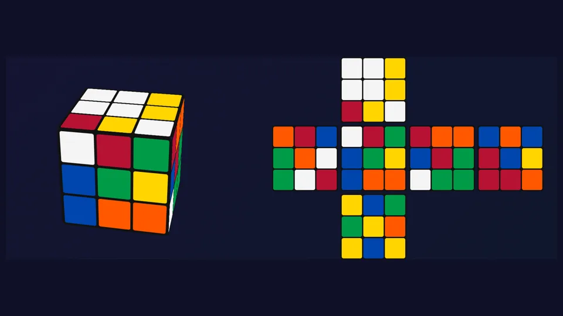
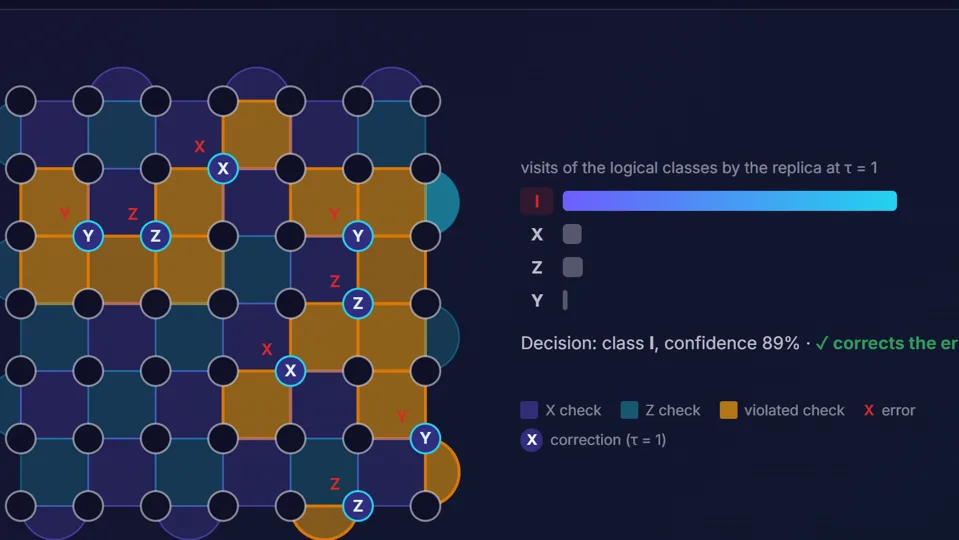
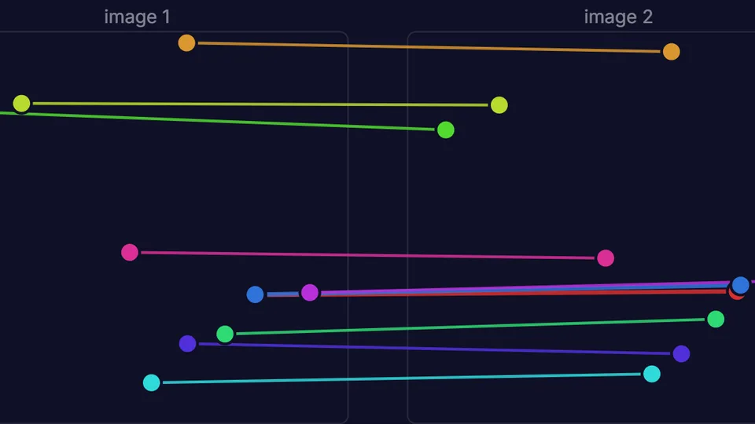

<p class="nb-kicker">Live demo</p>

## Watch it solve a jigsaw puzzle

<p class="nb-section-lead">A picture is cut into tiles and shuffled. NIMBUS puts it back together in your browser, and every
arrangement it visits uses each tile exactly once.</p>

<div class="nb-demo-wide" markdown>
<div id="nimbus-jigsaw-demo"></div>
</div>

??? info "How the demo works"

    The spins place every tile in exactly one slot and every slot holds one tile: a permutation, the same constraint as
    graph matching. The energy is the mismatch of the pixels along the edges of neighbouring tiles. The moves exchange
    two tiles, exchange two blocks of tiles, or shift a block of tiles along its rows or columns. Each of them maps a
    complete arrangement to another complete arrangement, so every state the machine visits uses each tile exactly
    once. The panel on the right shows the spins: one selected spin per row and per column at every iteration. Tiles
    are numbered by their position in the picture, so the solved arrangement appears as the diagonal. The machine uses
    only the pixel mismatch along tile edges, not these numbers. The acceptance rule, temperature calibration and
    annealing schedule are those of the package. More demos: [Demos](demos/index.md).

<p class="nb-kicker">The package</p>

## What NIMBUS provides

<div class="grid cards" markdown>

-   :material-swap-horizontal-bold:{ .lg .middle } __Constraints as moves__

    ---

    The machine changes its state only through moves that keep every constraint satisfied, so the energy needs no
    penalty terms. For a small problem, the moves can be found automatically from its feasible states.

    [:octicons-arrow-right-24: Supported constraints](concepts/constraints.md)

-   :material-vector-polyline:{ .lg .middle } __Interactions of any order__

    ---

    The energy is a polynomial of any order in the spins. Each move neuron receives its energy change through
    switched connections from the clause neurons.

    [:octicons-arrow-right-24: How NIMBUS works](concepts/index.md)

-   :material-cog-transfer-outline:{ .lg .middle } __A compiler__

    ---

    Turns the objective, the constraints and a move library into the wiring of the machine, adding auxiliary clauses
    where a switch needs them.

    [:octicons-arrow-right-24: Solving a new problem](guides/new_problem/index.md)

-   :material-lightning-bolt-outline:{ .lg .middle } __CPU and GPU backends__

    ---

    Event-driven emulation with compiled CPU kernels and an optional CUDA backend, with replicas, automatic temperature
    calibration and parallel tempering.

    [:octicons-arrow-right-24: Settings](guides/settings.md#backends)

-   :material-atom:{ .lg .middle } __Surface-code decoding__

    ---

    Decoders for one syndrome per shot and for real-time decoding of a syndrome stream, with CPU baselines.

    [:octicons-arrow-right-24: Surface-code decoding](problems/surface_code.md)

-   :material-chip:{ .lg .middle } __FPGA decoders__

    ---

    Both decoders on an RFSoC 4x2 board, bit-exact with their software models, with the RTL, generators and build
    scripts.

    [:octicons-arrow-right-24: Hardware](hardware/index.md)

</div>

<p class="nb-kicker">More demos</p>

## See it on other problems

<div class="grid cards nb-gallery" markdown>

-   [{ .nb-thumb loading=lazy }](demos/rubik.md)

    __Rubik's cube__

    Face turns and short commutators solve a scrambled cube; every state is a valid cube.

-   [{ .nb-thumb loading=lazy }](demos/surface_code.md)

    __Surface-code decoding__

    Place errors and watch the machine sample corrections and pick the most likely logical class.

-   [{ .nb-thumb loading=lazy }](demos/graph_matching.md)

    __Graph matching__

    Match two point sets by triangle similarity; drag the points while it runs.

</div>

<p class="nb-kicker">Get started</p>

## Install and run

=== "From source (recommended)"

    ```bash
    git clone https://github.com/aimlab-wustl/Nimbus.git
    cd Nimbus
    python -m venv .venv
    source .venv/bin/activate          # Windows: .venv\Scripts\activate
    pip install -e ".[dev]"
    ```

=== "pip from GitHub"

    ```bash
    pip install "nimbus-ising @ git+https://github.com/aimlab-wustl/Nimbus.git"
    ```

Solve the graph-matching example from the command line,

```bash
nimbus solve examples/matching_small.yaml --output local_runs/matching
nimbus analyze local_runs/matching
```

or from Python:

```python
from nimbus import api

cfg = api.load_config("examples/matching_small.yaml")        # (1)!
outcome = api.solve(cfg, output_dir="local_runs/matching")   # (2)!
print([row.best_feasible_objective for row in outcome.rows]) # (3)!
```

1.  A run is one YAML configuration: the problem, its move library, the annealing schedule, the replicas and the
    backend.
2.  Compiles the problem and its moves into the machine, calibrates the start and end temperatures and anneals every
    replica.
3.  The lowest energy of a feasible state that each replica found.

[:octicons-arrow-right-24: Quickstart](getting-started/quickstart.md){ .md-button .md-button--primary }
[:octicons-arrow-right-24: Problems](problems/index.md){ .md-button }

<p class="nb-kicker">Cite</p>

## Citing

If you use NIMBUS, please cite the paper:

> Faiek Ahsan and Shantanu Chakrabartty. *Compiling Constraints into Neuromorphic Ising Machines.* arXiv:2611.25352, 2026. [https://arxiv.org/abs/2611.25352](https://arxiv.org/abs/2611.25352)

BibTeX and the Zenodo archive: [Citing](about/citing.md).

## Acknowledgements

This project is supported by the National Science Foundation grants ECCS-2332166 and FET-2551604.
