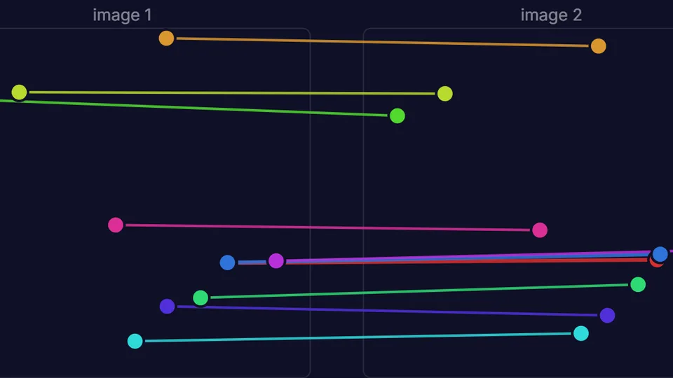
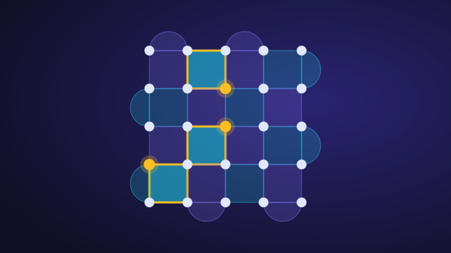
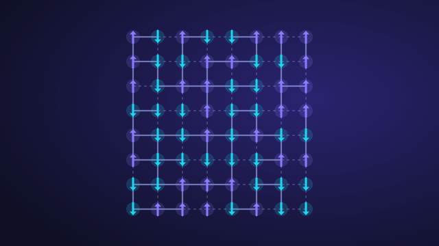
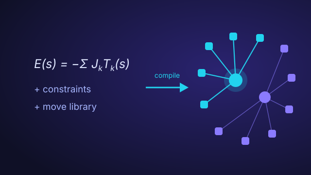

# Problems

Worked problems with their constraints, moves and commands. Each page lists the spins, the constraint, the objective,
the move library and how to run it.

-   [{ .nb-thumb loading=lazy }](graph_matching.md)

    __Graph matching__

    Third-order matching of two keypoint sets. Permutation constraint, row-exchange moves. The main benchmark of the
    paper, with a live demo.

    [:octicons-arrow-right-24: Graph matching](graph_matching.md)

-   [{ .nb-thumb loading=lazy }](surface_code.md)

    __Surface-code decoding__

    Decoding the rotated surface code, one syndrome per shot and in real time. Parity constraints, stabilizer and
    logical-operator moves.

    [:octicons-arrow-right-24: Surface-code decoding](surface_code.md)

-   [{ .nb-thumb loading=lazy }](examples.md)

    __Small examples__

    Configurations that run in seconds: the six-spin toy of the paper, a spin glass and one example of every
    constraint family.

    [:octicons-arrow-right-24: Small examples](examples.md)

-   [{ .nb-thumb loading=lazy }](../guides/new_problem/index.md)

    __Your own problem__

    An objective polynomial and constraints from a file, without code, or a problem adapter with its own move library.

    [:octicons-arrow-right-24: Solving a new problem](../guides/new_problem/index.md)

